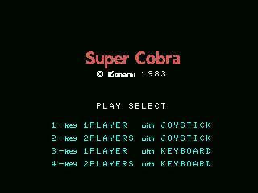
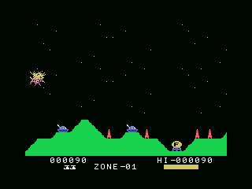
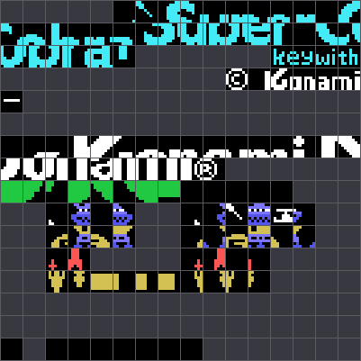

# What the cartridge draws

Under each caption is the address it comes from, and whether the picture is reconstructed or captured.

*openMSX SCREENSHOT — the title screen and menu, built by states 04 and 06. Keys 1 and 2 play with a joystick, 3 and 4 with the keyboard; what they pick is two bits of 0xE002*

*openMSX SCREENSHOT — a zone in progress: the terrain scrolling double-buffered from 0xE800, the scoreboard on top and the fuel gauge from 0x4F7C*

*openMSX SCREENSHOT — state 01, caught halfway: SUBE_LOGOTIPO (0x4CBF) raises the KONAMI from the bottom up, one 32-byte row every two frames*

*RECONSTRUCTED from 0x4248 — the 256 tiles of the top third with their colour, as MONTA_EL_TITULO leaves them. The grey ones are what the cartridge does not carry: that is where the BIOS letters land*

*RECONSTRUCTED from 0x443A — the 16×16 sprite drawings. That stream is the only thing in the whole cartridge writing to VRAM 0x1800, which is where VDP register 6 puts the sprite pattern table*

*FLOWN — the whole of zone 1, its 485 columns, with the rockets and the fuel tanks where the cartridge puts them. It is not read from the ROM, because it is not stored in the ROM: <code>tools/mapa.py</code> runs the cartridge on a Z80 interpreter written in Python, plays the game, and saves the column that comes in from the right on every scroll step*

*RECONSTRUCTED from 0x4CFA — the 26 tiles of the big KONAMI, 147 bytes identical to Athletic Land's, laid out the way the cartridge lays them: three tiles on top, eleven in the middle and twelve below*
