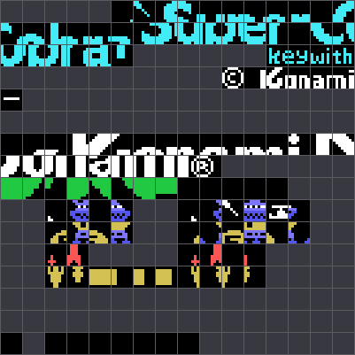
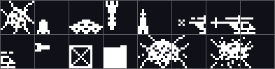

# Under the hood

## Getting started

This repository holds a **commented disassembly** of Super Cobra for the MSX
(Konami, 1983, cartridge RC-705). Everything here comes out of the binary and
can be regenerated from it.

### What you need

- **Python 3** (no third-party packages)
- **pasmo**, to reassemble
- **z80dasm**, used only for the mnemonics
- the cartridge image, which this repository **does not distribute**

The ROM goes in the root, as `supercobra.rom`. Exactly 8192 bytes:

    sha256  062aeefd04e6ac28f565c15bd1010fc2a007bfbe8d3898ff8586778462091470

`make comprueba` checks it.

### The commands

    make                # trace, listing, reassembly, checks and tests
    make listado        # rebuilds src/supercobra.asm from the annotations
    make verify         # reassembles and compares with the ROM, byte for byte
    make sanity         # nothing declared as data may come out as code,
                        # and no byte may be left unassigned
    make test           # the checks
    make imagenes       # rebuilds the drawings by reading the ROM
    make web            # rebuilds this site

### What is in each folder

| | |
|---|---|
| `src/supercobra.entries` | the entry points, each with its justification |
| `src/supercobra.nocode` | the ranges the tracer must not read as code |
| `src/supercobra.notes` | **the only file edited by hand**: all the annotations |
| `src/supercobra.asm` | the listing, generated by `tools/mkasm.py` |
| `tools/` | the tracer, the listing generator and the measuring tools |
| `tests/` | the checks on the listing and the annotations |
| `docs/` | this site |

### How to read the listing

Annotations are **anchored to an address**, so they survive a retrace. The
directives follow theNestruo's guidelines:

| | |
|---|---|
| `L` | a label and what the routine does |
| `C` | a comment on that line |
| `B` | a block header before that address |
| `D` | a data range, with its name and its explanation |
| `F` | the row width of a data block |

### How it was done

The tracer follows the real flow from the entry points. What cannot be deduced
statically —the interrupt hook, the two tables embedded behind a `call`— is
declared by hand in the `.entries`, with the reason written next to it.

This cartridge also has two routines that **are never reached by a `call`**:
0x4691 does a `push hl` with the address of one of them, and the dispatcher ends
in `jp (hl)`, so the `ret` of the state routine lands there. Without that,
0x488B and 0x49EA stayed declared as data while being code.

There is no assumption dressed up as a fact here. What is not known is in
[Open questions](CURIOSITIES.html), and it says so.

### Reproducibility

`make verify` reassembles the listing and compares the result with the original
ROM. It has to come out **identical, byte for byte**. And `make sanity` then
checks what reassembly cannot catch: that no range declared as data is being
read as code, and that **not a single one of the 8192 bytes** is left
unassigned.

## The cartridge

### The header and the machine

An 8 KB cartridge in **page 1**, from 0x4000 to 0x5FFF.

    4000  41 42 7d 40 00 00 00 00 ...      "AB", and behind it INIT = 0x407D

Only INIT is declared; the other three vectors are zero. INIT wipes 0xE000 to
0xF7FF in one go —all the RAM the game uses—, leaves the stack at 0xF800,
writes `jp 0x402B` into the H.KEYI hook (0xFD9A) and settles into a `jr $`
(0x40AD). From then on **the main thread never does anything again**: the whole
game runs inside the interrupt.

### Video memory

SCREEN 2, with the eight registers coming from 0x4830 and uploaded one by one by
0x4813:

| | |
|---|---|
| name table | 0x3800 |
| pattern table | 0x2000 |
| colour table | 0x0000 |
| sprite attributes | 0x3B00 |
| sprite patterns | 0x1800, 16×16 |

The addresses the code handles have 0x4000 added: that is the write bit `VPOKE`
sets on D before sending them to the VDP. That is why the listing reads
`ld de,06300h` where the real video memory is 0x2300.

SCREEN 2 splits patterns and colours into three 2 KB thirds, and this game wants
them identical: it builds the first and then copies **inside video memory
itself**, without reading the ROM again (`REPITE_TERCIOS`, 0x4A95).

### The letters are not in the cartridge

`SUBE_FUENTE` (0x4AA0) reads `CGTBL` —the pointer at address 0x0004 of the BASIC
ROM— and uploads **0x180 bytes of the machine's font**: 48 characters, from `0`
to `_`. The score digits and the menu words are the MSX's own letters, not
Konami artwork.

And it uploads them twice, with two different offsets and two different colours,
because in SCREEN 2 colour goes per pattern line and the same character cannot
have two colours.

*The 256 tiles of the top third after the title screen is built. The grey ones
are the ones the cartridge does not carry: that is where the letters copied from
the BIOS land.*

### The two drawing interpreters

The cartridge does not store graphics raw. It has two formats and two routines:

**`PINTA_DIBUJO` (0x4068)** — a video memory address, and behind it the bytes as
they are. `0xFE` closes the run and asks for another address; `0xFF` closes the
drawing. Its twin `BORRA_DIBUJO` (0x4064) is **the same routine**: it enters two
bytes earlier with C = 0x00 instead of 0xFF, and the `and c` at 0x4076 turns
every byte into a zero. One loop draws and erases.

**`PINTA_ROTULO` (0x4AC6)** — the compressed one. A command byte: with bit 7 set,
C distinct bytes follow; without it, one byte is repeated C times. `0x80` opens
another run at another address and `0x00` closes.

### The sprites

Sprite patterns have a single supplier: the stream at 0x443A, the only thing in
the whole cartridge that writes to video memory 0x1800. That is 144 bytes at
0x1800 and 328 at 0x18A8.

*The 16×16 sprite drawings, taken from video memory 0x1800. They come out white
because the colour is not in the drawing: it is in the attribute, four bytes per
sprite —row, column, drawing and colour—.*

The four attributes the ship starts with are at 0x41E4: two halves of the
helicopter in white, and two more below, one white and one red.

### The sound

Three channels of ten bytes each from 0xE010:

| | |
|---|---|
| +0 | what is left of the note |
| +1 | the duration |
| +2 | the sound number, which is what priority looks at |
| +3/+4 | the track pointer |
| +5 | the octave |
| +6 | the volume |
| +8 | the envelope |
| +9 | the chained sound |

A sound can take one, two or three channels, and its number decides: below 0x89
one, from 0x89 to 0x8C two, from 0x8D up three (0x5CAC).

The twelve periods in the table at 0x5E55 are **one byte each**: they are the
top octave, and the lower ones come out by doubling the period (0x5E43).

These 269 bytes are close relatives of Athletic Land's: see
[Findings](CURIOSITIES.html).

### What it is made of

| | bytes | |
|---|---|---|
| traced code | 5,783 | 70.59 % |
| identified data | 2,409 | 29.41 % |
| **unexplained** | **0** | **0.00 %** |

The cartridge has only three gaps: twelve zeros in the header (0x4004), ten at
0x506D and **twelve 0xFF bytes from 0x5FF4 to 0x5FFF**, behind the end of the
last sound track.

## The code

### Everything happens in the interrupt

INIT gets the machine ready and stops at a `jr $` (0x40AD) it never leaves. The
only thing running from then on is the H.KEYI hook, that is 0x402B, once per
frame.

And inside that hook the order matters:

    402B  in a,(099h)        reading VDP status drops the request
    402E  call SUENA         the sound, BEFORE the lock
    4031  ld a,(0E005h)      0xE005 is the lock
          or a / ret nz      if it is not zero, no second entry
    4038  ld (hl),a / ei     the lock is set and interrupts are opened

**The sound goes before the lock on purpose**: a game step can last more than one
frame, and the music has to keep playing over it. And interrupts are opened
*inside* the interrupt, with the lock already set, so that the next one comes in,
touches the sound and leaves without trampling the step still in progress.

### The dispatcher that never returns

`DESPACHA` (0x4050) does not keep its table apart. It does a `pop hl` —which does
not undo the call, it **takes the return address to use as a base**—, adds the
index doubled, reads the word and ends in `jp (hl)`. That is why the table sits
right behind the `call`, and why it is never returned to.

There are two:

| where | entries | index | |
|---|---|---|---|
| 0x46AD | 15 words | (0xE000) | the game state |
| 0x516F | 8 words | (0xE003) and 7 | the in-game submode |

Ending in `jp (hl)` instead of a `call` has a consequence: the `ret` of the
dispatched routine **does not go back to the dispatcher**, it goes back to
whatever the caller left on the stack. 0x4691 exploits that by doing a `push hl`
with the address of another routine before dispatching. That is what makes
0x488B and 0x49EA run without anyone calling them.

### The fifteen states

The state lives in 0xE000, and almost every routine ends in the same pair of
lines: 0x4742 puts A into 0xE004 —the timer— and falls into 0x4745, which bumps
0xE000. The ones that wait check 0xE004 with `dec (hl) / ret nz`.

| | |
|---|---|
| 00 | uploads the VDP registers and gets the screen up |
| 01 | raises the big KONAMI one row every two frames |
| 02, 03, 05 | waits |
| 04 | clears and builds the title screen |
| 06 | builds the PLAY SELECT menu |
| 07 | waits for a choice |
| 08 | the attract demo |
| 09 | takes a life off and announces whose turn it is |
| 10 | clears the announcement and lets the player go |
| 11 | **the game**; it stays here until 0xE06F goes off |
| 12 | checks whether the active player has lives left |
| 13 | changes turns |
| 14 | end of game, unless the other player is still alive |

08 is the odd one: it is the only one entered without a `push`, so its `ret` goes
back to the caller instead of to the dispatcher.

*State 01. `SUBE_LOGOTIPO` (0x4CBF) raises the KONAMI from the bottom up, one row
of 32 bytes per call, and draws it split in three: three tiles on top, eleven in
the middle and twelve below.*

### The eight submodes

Inside a game step, the table at 0x516F is indexed with **the frame counter** and
7. These are not states that follow one another: they are eight jobs that take
turns, one per frame, because they do not all fit in the same one.

| | |
|---|---|
| 0 | swaps buffers and uploads the terrain to the screen |
| 1 | the twin of 0 for the top half |
| 2 and 6 | the engine flame, and then move the flying things |
| 3 | burns fuel |
| 4 | moves the flying things, **without** touching the flame |
| 5 | releases what the terrain shoots |
| 7 | the difficulty |

4 is the only one of the eight that **does not enter at the start of a routine**:
it points at 0x5278, three instructions further into 2, right after the `call`
that moves the engine flame. The same routine does two different jobs depending
on where you come in.

### The terrain

The stage's terrain is built whole in RAM when the game starts
(`MONTA_EL_MAPA`, 0x4106), and it is built **double-buffered**: 0xE50D flips
between 0 and 1 with a `xor 1`, and the page comes out of that, 0xE800 with 0 and
0xEA00 with 1. While one is being dumped to video memory, the other is being
built.

Scrolling it one column is five batches of 0x1F bytes, each shifted by one place
(0x532F). Five rows, and 0x20 bytes between rows: one column top to bottom.

What gets laid into the buffer comes from a **recipe** (0x45E5): one byte per
stretch, the low two bits say what class it is and the rest says where it goes.

### The seven bytes that run in RAM

0x412B copies seven bytes from 0x41DD to 0xE5F8 and calls them as a routine from
then on. Set up over there, they are:

    E5F8  32 FD E5     ld (0E5FDh),a
    E5FB  DD 70 00     ld (ix+000h),b
    E5FE  C9           ret

0xE5FD **is the third byte of the `ld (ix+000h),b`**, that is, its own
displacement. The routine writes the displacement over itself with A and then
stores B: it is `ld (IX+A),B`, which the Z80 cannot do, because IX's displacement
is a fixed byte of the opcode and not a register.

That is why it has to run in RAM, and why those are **the only seven bytes of
this cartridge that do not run from ROM**.

### Collisions

`HAY_CHOQUE` (0x53DC) is one single test for everything: it subtracts the other
one's position and its width, adds its own width, and if that does not overflow,
they do not touch on that axis. The same on the other axis, and there is a
collision only if they overlap on both. The sizes always come in (HL), and each
thing brings its own table:

| | |
|---|---|
| 0x5607 | the flying things, four bytes per zone class |
| 0x55D3 | the bomb against the terrain, per tile family |
| 0x55E3 | the bomb, per attribute drawing |
| 0x55F3 | the shot, per attribute drawing |
| 0x5634 | tiles 0x87 and up, which take more than one cell |
| 0x5648 | the fuel dump at the end of the zone |
| 0x564C | the base |

Every frame three checks are chained (0x5139) and **as soon as one sets carry the
rest are skipped**. Between columns 0x99 and 0xA1 none of them is checked: that
is the stage change.

## Code shared with other Konami cartridges

This disassembly has been compared, instruction by instruction, with
every other Konami one in the series. A block counts when the same
instructions, at least six of them from a label to its `ret` or its
unconditional jump, are in both cartridges; the addresses are left
aside, because they change from one cartridge to the next. Of the
other 57, **39** have at least one block in common with this one;
these are the ones that share the most:

| Cartridge | Blocks | Instructions | For example (here = there) |
|---|---:|---:|---|
| [Circus Charlie](https://antxiko.github.io/CircusCharlie-disassembly/) | 18 | 242 | `MIRA_VIDA_EXTRA` (0x494F) = `mira_la_vida_extra` |
| [Magical Tree](https://antxiko.github.io/MagicalTree-disassembly/) | 17 | 216 | `EL_VOLUMEN_DEL_EFECTO` (0x5D97) = `lee_la_nota_de_la_partitura` |
| [Konami’s Mahjong Dojo](https://antxiko.github.io/KonamisMahjongDojo-disassembly/) | 12 | 123 | `PINTA_ROTULO` (0x4AC6) = `pinta_lista_formato_b` |
| [Athletic Land](https://antxiko.github.io/AthleticLand-disassembly/) | 11 | 116 | `MUSICA_PERIODO` (0x5E2F) |
| [Cabbage Patch Kids](https://antxiko.github.io/CabbagePatchKids-disassembly/) | 10 | 97 | `SONIDO_ENCADENADO` (0x5CF9) = `SONIDO_SIGUIENTE_VUELTA` |
| [Hyper Sports 1](https://antxiko.github.io/HyperSports1-disassembly/) | 9 | 117 | `SUBE_LOGOTIPO` (0x4CBF) = `DESCOMPRIME_A_TERCIOS_4748` |
| [Monkey Academy](https://antxiko.github.io/MonkeyAcademy-disassembly/) | 9 | 136 | `MUSICA_EVENTO` (0x5DF4) |
| [Comic Bakery](https://antxiko.github.io/ComicBakery-disassembly/) | 8 | 97 | `PARPADEA_EL_JUGADOR` (0x49EA) = `parpadea_el_turno` |
| [Antarctic Adventure](https://antxiko.github.io/AntarcticAdventure-disassembly/) | 6 | 98 | `MUSICA_EVENTO` (0x5DF4) = `VOLUMEN_MIRA_FD` |
| [Hyper Sports 2](https://antxiko.github.io/HyperSports2-disassembly/) | 6 | 48 | `EL_CANAL_SIGUIENTE` (0x5D3D) = `VUELTA_DE_UN_CANAL` |

The whole matrix, the 58 cartridges against each other, is on
[The routines](https://antxiko.github.io/MSX-disassembly-database/THE-ROUTINES.html) in the series database, along
with the method and the program that measures it.
