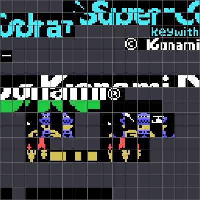
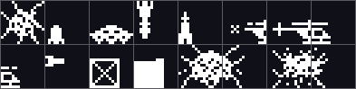

# El cartucho

## La cabecera y la máquina

Un cartucho de 8 KB en la **página 1**, de 0x4000 a 0x5FFF.

    4000  41 42 7d 40 00 00 00 00 ...      "AB", y detrás INIT = 0x407D

Solo se declara INIT; los otros tres vectores van a cero. INIT borra de golpe
0xE000 a 0xF7FF —toda la RAM que el juego usa—, deja la pila en 0xF800,
escribe `jp 0x402B` en el gancho H.KEYI (0xFD9A) y se queda en un `jr $`
(0x40AD). A partir de ahí **el hilo principal no vuelve a hacer nada**: el
juego entero corre dentro de la interrupción.

## La memoria de vídeo

SCREEN 2, con los ocho registros saliendo de 0x4830 y subidos uno a uno por
0x4813:

| | |
|---|---|
| tabla de nombres | 0x3800 |
| tabla de patrones | 0x2000 |
| tabla de color | 0x0000 |
| atributos de sprite | 0x3B00 |
| patrones de sprite | 0x1800, de 16×16 |

Las direcciones que el código maneja llevan sumado 0x4000: es el bit de
escritura que `VPOKE` le pone a D antes de mandarlas al VDP. Por eso en el
listado se lee `ld de,06300h` donde la memoria de vídeo de verdad es la 0x2300.

SCREEN 2 parte los patrones y los colores en tres tercios de 2 KB, y este juego
los quiere iguales: monta el primero y luego copia **dentro de la propia
memoria de vídeo**, sin volver a leer la ROM (`REPITE_TERCIOS`, 0x4A95).

## Las letras no están en el cartucho

`SUBE_FUENTE` (0x4AA0) lee `CGTBL` —el puntero de la dirección 0x0004 de la ROM
del BASIC— y sube **0x180 bytes de la fuente de la máquina**: 48 caracteres,
del `0` al `_`. Las cifras del marcador y las palabras del menú son las letras
del MSX, no dibujos de Konami.

Y las sube dos veces, con dos desplazamientos distintos y dos colores
distintos, porque en SCREEN 2 el color va por línea de patrón y el mismo
carácter no puede tener dos colores.

*Los 256 tiles del tercio de arriba después de montar la pantalla del título.
Los grises son los que el cartucho no trae: ahí es donde caen las letras que se
copian de la BIOS.*

## Los dos intérpretes de dibujo

El cartucho no guarda los gráficos en crudo. Tiene dos formatos y dos rutinas:

**`PINTA_DIBUJO` (0x4068)** — dirección de memoria de vídeo, y detrás los bytes
tal cual. `0xFE` cierra el tramo y manda leer otra dirección; `0xFF` cierra el
dibujo. Su gemela `BORRA_DIBUJO` (0x4064) es **la misma rutina**: entra por dos
bytes antes con C = 0x00 en vez de 0xFF, y el `and c` de 0x4076 convierte cada
byte en un cero. Un solo bucle pinta y borra.

**`PINTA_ROTULO` (0x4AC6)** — la versión comprimida. Un byte de mando: con el
bit 7 puesto vienen C bytes distintos, sin él se repite uno C veces. `0x80` abre
otro tramo en otra dirección y `0x00` cierra.

## Los sprites

Los patrones de sprite tienen un solo proveedor: el flujo de 0x443A, que es lo
único de todo el cartucho que escribe en la memoria de vídeo 0x1800. Son 144
bytes en 0x1800 y 328 en 0x18A8.

*Los dibujos de sprite de 16×16, sacados de la memoria de vídeo 0x1800. Salen
en blanco porque el color no está en el dibujo: lo pone la ficha, cuatro bytes
por sprite —fila, columna, dibujo y color—.*

Las cuatro fichas con las que arranca la nave están en 0x41E4: dos mitades del
helicóptero en blanco, y dos más abajo, una blanca y otra roja.

## El sonido

Tres canales de diez bytes cada uno desde 0xE010:

| | |
|---|---|
| +0 | lo que queda de la nota |
| +1 | la duración |
| +2 | el número de sonido, que es lo que mira la prioridad |
| +3/+4 | el puntero de la pista |
| +5 | la octava |
| +6 | el volumen |
| +8 | la envolvente |
| +9 | el sonido encadenado |

Un sonido puede llevarse uno, dos o tres canales, y lo decide su número: por
debajo del 0x89 uno, del 0x89 al 0x8C dos, del 0x8D en adelante tres (0x5CAC).

Los doce periodos de la tabla de 0x5E55 son **un byte cada uno**: son los de la
octava más alta, y las de abajo salen doblando el periodo (0x5E43).

Estos 269 bytes son casi los mismos que los de Athletic Land: ver
[Hallazgos](HALLAZGOS.html).

## De qué está hecho

| | bytes | |
|---|---|---|
| código trazado | 5.783 | 70,59 % |
| datos identificados | 2.409 | 29,41 % |
| **sin explicar** | **0** | **0,00 %** |

Los únicos huecos del cartucho son tres: doce ceros en la cabecera (0x4004),
diez en 0x506D y **doce bytes de 0xFF de 0x5FF4 a 0x5FFF**, detrás del final de
la última pista de sonido.
