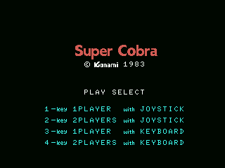
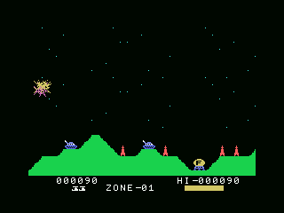

# El juego

Se pilota un helicóptero de izquierda a derecha sobre un terreno que corre, se
dispara hacia delante y se sueltan bombas hacia abajo, y hay que llegar al
final de cada zona sin chocar y sin quedarse sin combustible.

## El menú

Cuatro líneas y cuatro teclas. `LEE_TECLAS_DE_MENU` (0x488B) lee la fila 0 del
teclado, se queda con los bits 1 a 4 —las teclas 1, 2, 3 y 4— y las traduce por
la tabla de 0x48AC:

| tecla | |
|---|---|
| 1 | un jugador, joystick |
| 2 | dos jugadores, joystick |
| 3 | un jugador, teclado |
| 4 | dos jugadores, teclado |

Lo que elige la tecla es el bit 4 de 0xE002 (teclado o joystick) y el bit 5
(uno o dos jugadores). Con el teclado, `LEE_TECLADO` (0x4863) arma **el mismo
byte** que daría el joystick a partir de las filas 7 y 8: las cuatro flechas, el
espacio y SELECT. De ahí para abajo, al juego le da igual de dónde vino.

## Las vidas y los dos jugadores

Cada jugador tiene un bloque de **32 bytes**: 0xE050 el que está jugando y
0xE080 el que espera. El primer byte son las vidas, y arranca en 3 (0x490D).

El cambio de turno (0x4778) intercambia los dos bloques enteros con
`INTERCAMBIA` y de paso le da la vuelta al bit 7 de 0xE002, que es el que decide
en 0x4838 **qué joystick se lee**. Un solo juego, dos marcadores, y el que manda
siempre está en 0xE050.

## El combustible

Es un solo byte, 0xE51C, y lo gasta el submodo 3 (0x5291). A ese submodo le
toca uno de cada ocho fotogramas y además exige que los bits 2 a 5 del contador
estén a cero: **una bajada cada 64 fotogramas**, poco más de un segundo.

Quedarse sin combustible **no mata**. Cuando el `dec` se pasa de cero, el byte
se devuelve a cero y se enciende 0xE560; y 0xE560 puesto es, en `MUEVE_LA_NAVE`
(0x5185), lo que hace que la nave baje sola sin tocar el mando. Lo que mata es
lo que hay debajo.

La barra se pinta dividiendo entre cuatro: el cociente son las casillas llenas
(el tile 0xC4) y **el resto, de 1 a 3, elige la casilla a medias**, que son los
tres dibujos siguientes al 0xC4 (0x4F7C).

## Disparar

`DISPARA_O_BOMBEA` (0x51B1) mira el **flanco** del botón, no si está pulsado:
`cpl` sobre lo del fotograma anterior (0xE008) y `and` con lo de ahora (0xE009)
deja pasar solo el fotograma en que pasa de suelto a apretado. Sin eso, tener el
botón apretado dispararía sesenta veces por segundo.

Hacia dónde sale el disparo lo deciden **los tres bits bajos de la fila** de la
nave (0x51C7), y el dibujo es 0xF0 más eso. Antes de darlo de alta se mira el
tile de donde iría a parar: por debajo del tile 6 es cielo y el disparo cabe; si
no, el hueco se deja libre y no sale nada.

La bomba (0x51FD) se suelta doce píxeles por delante de la segunda mitad de la
nave, y solo puede haber una en el aire (0xE51F).

## Las zonas

Hay dos números de zona y no son el mismo:

- **0xE051** es el que se pinta, y va en BCD.
- **0xE053** es el de verdad, y sirve de índice.

Cada zona son **0xB6 columnas** (0x53C5), y 0xE50B lleva la cuenta de lo que
falta para llegar. A falta de 0x12 columnas suena el aviso de que se llega.

Los **dos bits bajos** de 0xE053 dicen de qué clase es la zona, así que el ciclo
se repite cada cuatro. La clase decide cuatro cosas: qué fichas de sprite se
montan (0x504A, cuatro por clase), qué tamaño tienen para los choques (0x5607,
cuatro bytes por clase), cuál de las tres rutinas mueve lo que vuela (0x52F5) y
cuál es la que remata el rótulo de fase pasada (0x522C).

Superar una zona paga **1500 puntos** y cada tres zonas repone el depósito.

## Lo que sale a por ti

El submodo 7 (0x52CD) es el que sube la dificultad, y lo hace con la fase:
**antes de la fase 3 la cuenta es cero**, de la 3 en adelante sube, y **de la 15
no pasa** (0x0C es el tope). Esa cuenta, por dos, se compara contra dos bits del
contador de fotogramas: cuanto más avanzada la fase, más a menudo sale algo.

Cuántos pueden estar en el aire a la vez sale de la tabla de 0x58D6, indexada
por la zona con tope 12. Y en la zona 0 no dispara nadie: es la de aprender.

## El marcador

Todo en BCD, con `daa` detrás de cada suma, y tres bytes por marcador: 0xE040 el
récord, 0xE043 el jugador 1, 0xE046 el jugador 2.

La vida extra se lleva en 0xE052, y lo que se compara es **el byte alto**, así
que el escalón son decenas de millar: `add a,002h` en BCD sobre ese byte deja la
vida extra **cada 20.000 puntos**. Al pasarse, el byte se pone a 0xFF y ya no
hay más vidas extra en esa partida.

Si el marcador pasa de 999999 lo que se planta en el máximo **es el récord**
(0xE040-0xE042); los puntos del jugador dan la vuelta y siguen.

## El dado

`PUNTOS_DE_PREMIO` (0x501E) da cincuenta puntos fijos o una cantidad sorteada, y
el sorteo lo hace con **el registro R del Z80** —el contador de refresco de la
memoria—: sus dos bits bajos dan 0, 1, 2 o 3, y eso se sube al byte alto. El
premio es 0, 100, 200 o 300 puntos.

## Llegar

Al final de la zona hay un depósito. `MIRA_SI_ATERRIZA` (0x50A1) lo compara con
la nave usando los cuatro márgenes de 0x5648; tocado, 0xE54B pasa a 1 —que es
aterrizando— y la ficha se queda con el dibujo 4.

Y cuando se llega del todo, `LLEGA_A_LA_BASE` (0x5C41) borra los cuatro disparos
que hubiera en el aire, apaga las dos fichas del depósito, pinta el cartel
**INVASION SUCCEEDED** y paga otros 1500 puntos. El mismo cartel se borra
después entrando por 0x4064 en vez de por 0x4068: la misma rutina, con C a cero.
