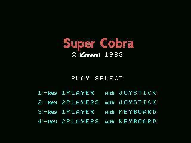
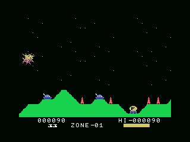
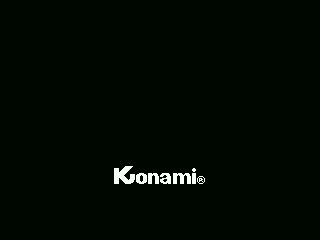
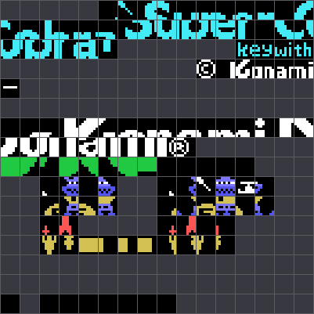
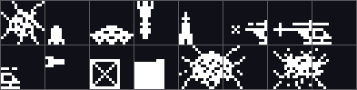

# Lo que el cartucho dibuja

Debajo de cada pie está la dirección de donde sale, y si la imagen es reconstruida o capturada.

*CAPTURA de openMSX — la pantalla del título y el menú, montada por el estado 04 y el 06. Las teclas 1 y 2 juegan con joystick, la 3 y la 4 con el teclado; lo que eligen son dos bits de 0xE002*

*CAPTURA de openMSX — una zona en marcha: el decorado que corre a doble búfer desde 0xE800, el marcador de arriba y la barra de combustible de 0x4F7C*

*CAPTURA de openMSX — el estado 01, cazado a medias: SUBE_LOGOTIPO (0x4CBF) sube el KONAMI de abajo arriba, una fila de 32 bytes cada dos fotogramas*

*RECONSTRUIDA de 0x4248 — los 256 tiles del tercio de arriba con su color, tal como los deja MONTA_EL_TITULO. Los grises son los que el cartucho no trae: ahí caen las letras que se copian de la BIOS*

*RECONSTRUIDA de 0x443A — los dibujos de sprite de 16×16. Ese flujo es lo único de todo el cartucho que escribe en la VRAM 0x1800, que es donde el registro 6 del VDP pone la tabla de patrones de sprite*

*VOLADA — la zona 1 entera, sus 485 columnas, con los cohetes y los depósitos donde el cartucho los pone. No está leída de la ROM, porque no está guardada en la ROM: <code>tools/mapa.py</code> ejecuta el cartucho en un intérprete de Z80 escrito en Python, juega la partida y va guardando la columna que entra por la derecha en cada paso de scroll*

*RECONSTRUIDA de 0x4CFA — los 26 tiles del KONAMI grande, 147 bytes idénticos a los de Athletic Land, montados como los monta el cartucho: tres tiles arriba, once en medio y doce abajo*
