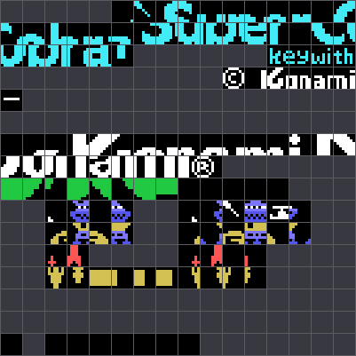
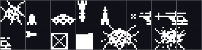
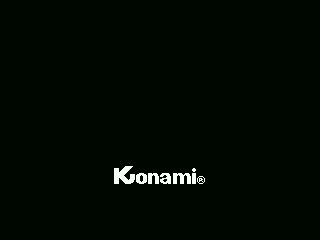

# Por dentro

## Empezar

Este repositorio contiene un **desensamblado comentado** de Super Cobra para
MSX (Konami, 1983, cartucho RC-705). Todo lo que hay aquí sale del binario y se
puede volver a generar desde él.

### Lo que hace falta

- **Python 3** (sin paquetes de terceros)
- **pasmo**, para reensamblar
- **z80dasm**, que solo se usa para los mnemónicos
- la imagen del cartucho, que este repositorio **no distribuye**

La ROM va en la raíz, como `supercobra.rom`. Son 8192 bytes exactos:

    sha256  062aeefd04e6ac28f565c15bd1010fc2a007bfbe8d3898ff8586778462091470

`make comprueba` lo verifica.

### Los comandos

    make                # trazado, listado, reensamblado, comprobaciones y tests
    make listado        # rehace src/supercobra.asm a partir de las anotaciones
    make verify         # reensambla y compara con la ROM, byte a byte
    make sanity         # nada declarado como datos puede salir como código,
                        # y ni un byte puede quedarse sin asignar
    make test           # las comprobaciones
    make imagenes       # rehace los dibujos leyendo la ROM
    make web            # rehace esta web

### Qué hay en cada carpeta

| | |
|---|---|
| `src/supercobra.entries` | los puntos de entrada, cada uno con su justificación |
| `src/supercobra.nocode` | los rangos que el trazador no debe leer como código |
| `src/supercobra.notes` | **lo único que se edita a mano**: todas las anotaciones |
| `src/supercobra.asm` | el listado, lo genera `tools/mkasm.py` |
| `tools/` | el trazador, el generador del listado y las herramientas de medida |
| `tests/` | las comprobaciones sobre el listado y las anotaciones |
| `docs/` | esta web |

### Cómo se lee el listado

Las anotaciones van **ancladas a una dirección**, así que sobreviven a un
retrazado. Las directivas siguen las pautas de theNestruo:

| | |
|---|---|
| `L` | una etiqueta y qué hace la rutina |
| `C` | un comentario en esa línea |
| `B` | una cabecera de bloque antes de esa dirección |
| `D` | un rango de datos, con su nombre y su explicación |
| `F` | la anchura de las filas de un bloque de datos |

### Cómo se hizo

El trazador sigue el flujo real desde los puntos de entrada. Lo que no se puede
deducir estáticamente —el gancho de la interrupción, las dos tablas incrustadas
detrás de un `call`— se declara a mano en el `.entries`, con la razón escrita al
lado.

Este cartucho tiene además dos rutinas a las que **no se llega con un `call`**:
0x4691 hace `push hl` con la dirección de una de ellas y el despachador termina
en `jp (hl)`, así que el `ret` de la rutina de estado aterriza ahí. Sin eso,
0x488B y 0x49EA se quedaban declaradas como datos siendo código.

Aquí no hay ninguna suposición disfrazada de hecho. Lo que no se sabe está en
[Preguntas abiertas](CURIOSIDADES.html) y lo dice.

### Que se pueda repetir

`make verify` reensambla el listado y compara el resultado con la ROM original.
Tiene que salir **idéntico, byte a byte**. Y `make sanity` comprueba después lo
que el reensamblado no puede cazar: que ningún rango declarado como datos se
esté leyendo como código, y que **ni uno solo de los 8192 bytes** se quede sin
asignar.

## El cartucho

### La cabecera y la máquina

Un cartucho de 8 KB en la **página 1**, de 0x4000 a 0x5FFF.

    4000  41 42 7d 40 00 00 00 00 ...      "AB", y detrás INIT = 0x407D

Solo se declara INIT; los otros tres vectores van a cero. INIT borra de golpe
0xE000 a 0xF7FF —toda la RAM que el juego usa—, deja la pila en 0xF800,
escribe `jp 0x402B` en el gancho H.KEYI (0xFD9A) y se queda en un `jr $`
(0x40AD). A partir de ahí **el hilo principal no vuelve a hacer nada**: el
juego entero corre dentro de la interrupción.

### La memoria de vídeo

SCREEN 2, con los ocho registros saliendo de 0x4830 y subidos uno a uno por
0x4813:

| | |
|---|---|
| tabla de nombres | 0x3800 |
| tabla de patrones | 0x2000 |
| tabla de color | 0x0000 |
| atributos de sprite | 0x3B00 |
| patrones de sprite | 0x1800, de 16×16 |

Las direcciones que el código maneja llevan sumado 0x4000: es el bit de
escritura que `VPOKE` le pone a D antes de mandarlas al VDP. Por eso en el
listado se lee `ld de,06300h` donde la memoria de vídeo de verdad es la 0x2300.

SCREEN 2 parte los patrones y los colores en tres tercios de 2 KB, y este juego
los quiere iguales: monta el primero y luego copia **dentro de la propia
memoria de vídeo**, sin volver a leer la ROM (`REPITE_TERCIOS`, 0x4A95).

### Las letras no están en el cartucho

`SUBE_FUENTE` (0x4AA0) lee `CGTBL` —el puntero de la dirección 0x0004 de la ROM
del BASIC— y sube **0x180 bytes de la fuente de la máquina**: 48 caracteres,
del `0` al `_`. Las cifras del marcador y las palabras del menú son las letras
del MSX, no dibujos de Konami.

Y las sube dos veces, con dos desplazamientos distintos y dos colores
distintos, porque en SCREEN 2 el color va por línea de patrón y el mismo
carácter no puede tener dos colores.

*Los 256 tiles del tercio de arriba después de montar la pantalla del título.
Los grises son los que el cartucho no trae: ahí es donde caen las letras que se
copian de la BIOS.*

### Los dos intérpretes de dibujo

El cartucho no guarda los gráficos en crudo. Tiene dos formatos y dos rutinas:

**`PINTA_DIBUJO` (0x4068)** — dirección de memoria de vídeo, y detrás los bytes
tal cual. `0xFE` cierra el tramo y manda leer otra dirección; `0xFF` cierra el
dibujo. Su gemela `BORRA_DIBUJO` (0x4064) es **la misma rutina**: entra por dos
bytes antes con C = 0x00 en vez de 0xFF, y el `and c` de 0x4076 convierte cada
byte en un cero. Un solo bucle pinta y borra.

**`PINTA_ROTULO` (0x4AC6)** — la versión comprimida. Un byte de mando: con el
bit 7 puesto vienen C bytes distintos, sin él se repite uno C veces. `0x80` abre
otro tramo en otra dirección y `0x00` cierra.

### Los sprites

Los patrones de sprite tienen un solo proveedor: el flujo de 0x443A, que es lo
único de todo el cartucho que escribe en la memoria de vídeo 0x1800. Son 144
bytes en 0x1800 y 328 en 0x18A8.

*Los dibujos de sprite de 16×16, sacados de la memoria de vídeo 0x1800. Salen
en blanco porque el color no está en el dibujo: lo pone la ficha, cuatro bytes
por sprite —fila, columna, dibujo y color—.*

Las cuatro fichas con las que arranca la nave están en 0x41E4: dos mitades del
helicóptero en blanco, y dos más abajo, una blanca y otra roja.

### El sonido

Tres canales de diez bytes cada uno desde 0xE010:

| | |
|---|---|
| +0 | lo que queda de la nota |
| +1 | la duración |
| +2 | el número de sonido, que es lo que mira la prioridad |
| +3/+4 | el puntero de la pista |
| +5 | la octava |
| +6 | el volumen |
| +8 | la envolvente |
| +9 | el sonido encadenado |

Un sonido puede llevarse uno, dos o tres canales, y lo decide su número: por
debajo del 0x89 uno, del 0x89 al 0x8C dos, del 0x8D en adelante tres (0x5CAC).

Los doce periodos de la tabla de 0x5E55 son **un byte cada uno**: son los de la
octava más alta, y las de abajo salen doblando el periodo (0x5E43).

Estos 269 bytes son casi los mismos que los de Athletic Land: ver
[Hallazgos](CURIOSIDADES.html).

### De qué está hecho

| | bytes | |
|---|---|---|
| código trazado | 5.783 | 70,59 % |
| datos identificados | 2.409 | 29,41 % |
| **sin explicar** | **0** | **0,00 %** |

Los únicos huecos del cartucho son tres: doce ceros en la cabecera (0x4004),
diez en 0x506D y **doce bytes de 0xFF de 0x5FF4 a 0x5FFF**, detrás del final de
la última pista de sonido.

## El código

### Todo pasa en la interrupción

INIT deja la máquina lista y se para en un `jr $` (0x40AD) del que no sale
nunca. Lo único que corre a partir de ahí es el gancho H.KEYI, o sea 0x402B, una
vez por fotograma.

Y dentro de ese gancho el orden importa:

    402B  in a,(099h)        leer el estado del VDP baja la petición
    402E  call SUENA         el sonido, ANTES del candado
    4031  ld a,(0E005h)      0xE005 es el candado
          or a / ret nz      si no está a cero, no se entra otra vez
    4038  ld (hl),a / ei     se echa el candado y se abren las interrupciones

**El sonido va antes del candado a propósito**: un paso del juego puede durar
más de un fotograma, y la música tiene que seguir sonando por encima. Y las
interrupciones se abren *dentro* de la interrupción, con el candado ya echado,
para que la siguiente entre, toque el sonido y se vuelva sin pisar el paso que
sigue a medias.

### El despachador que no vuelve

`DESPACHA` (0x4050) no lleva la tabla aparte. Hace `pop hl` —que no deshace la
llamada, sino que **coge la dirección de retorno para usarla de base**—, suma el
índice por dos, lee la palabra y termina en `jp (hl)`. Por eso la tabla va
pegada justo detrás del `call`, y por eso no se vuelve nunca a él.

Hay dos:

| dónde | entradas | índice | |
|---|---|---|---|
| 0x46AD | 15 palabras | (0xE000) | el estado del juego |
| 0x516F | 8 palabras | (0xE003) and 7 | el submodo de la partida |

Que termine en `jp (hl)` en vez de en `call` tiene una consecuencia: el `ret` de
la rutina despachada **no vuelve al despachador**, vuelve a lo que hubiera
dejado el llamador en la pila. 0x4691 se aprovecha de eso haciendo `push hl` con
la dirección de otra rutina antes de despachar. Es lo que hace que 0x488B y
0x49EA se ejecuten sin que nadie las llame.

### Los quince estados

El estado vive en 0xE000 y casi todas las rutinas acaban en el mismo par de
líneas: 0x4742 deja A en 0xE004 —el temporizador— y cae en 0x4745, que sube
0xE000. Los que esperan miran 0xE004 con `dec (hl) / ret nz`.

| | |
|---|---|
| 00 | sube los registros del VDP y deja la pantalla puesta |
| 01 | sube el KONAMI grande una fila cada dos fotogramas |
| 02, 03, 05 | esperas |
| 04 | limpia y monta la pantalla del título |
| 06 | monta el menú de PLAY SELECT |
| 07 | espera a que se elija |
| 08 | la demostración |
| 09 | descuenta una vida y anuncia de quién es el turno |
| 10 | borra el anuncio y suelta al jugador |
| 11 | **el juego**; aquí se está hasta que 0xE06F se apaga |
| 12 | mira si al jugador activo le quedan vidas |
| 13 | cambia el turno |
| 14 | fin de partida, salvo que el otro jugador siga vivo |

El 08 es el raro: es el único al que se entra sin `push`, así que su `ret`
vuelve al llamador en vez de al despachador.

*El estado 01. `SUBE_LOGOTIPO` (0x4CBF) sube el KONAMI de abajo arriba, una fila
de 32 bytes por llamada, y lo pinta partido en tres: tres tiles arriba, once en
medio y doce abajo.*

### Los ocho submodos

Dentro de un paso de partida, la tabla de 0x516F se indexa con **el contador de
fotogramas** y 7. No son estados que se sucedan: son ocho trabajos que se
turnan, uno por fotograma, porque no caben todos en el mismo.

| | |
|---|---|
| 0 | cambia de búfer y sube el decorado a la pantalla |
| 1 | el gemelo del 0 para la mitad de arriba |
| 2 y 6 | la llama del motor, y luego mueven lo que vuela |
| 3 | gasta combustible |
| 4 | mueve lo que vuela, **sin** tocar la llama |
| 5 | suelta lo que dispara el decorado |
| 7 | la dificultad |

El 4 es el único de los ocho que **no entra por el principio de una rutina**:
apunta a 0x5278, tres instrucciones más adentro del 2, justo detrás del `call`
que mueve la llama del motor. La misma rutina hace dos trabajos distintos según
por dónde se entre.

### El decorado

El terreno de la fase se monta entero en la RAM al empezar la partida
(`MONTA_EL_MAPA`, 0x4106), y se monta **a doble búfer**: 0xE50D alterna entre 0
y 1 con un `xor 1`, y de ahí sale la página, 0xE800 con el 0 y 0xEA00 con el 1.
Mientras uno se vuelca a la memoria de vídeo, el otro se está montando.

Correrlo una columna son cinco tandas de 0x1F bytes, cada una desplazada un
sitio (0x532F). Cinco filas, y entre fila y fila 0x20 bytes: una columna de
arriba abajo.

Lo que se despliega en el búfer sale de una **receta** (0x45E5): un byte por
tramo, los dos bits bajos dicen de qué clase es y el resto, dónde va.

### Los siete bytes que se ejecutan en la RAM

0x412B copia siete bytes de 0x41DD a 0xE5F8 y desde entonces se los llama como
rutina. Montados allá son:

    E5F8  32 FD E5     ld (0E5FDh),a
    E5FB  DD 70 00     ld (ix+000h),b
    E5FE  C9           ret

0xE5FD **es el tercer byte del `ld (ix+000h),b`**, o sea su propio
desplazamiento. La rutina se escribe encima el desplazamiento con A y entonces
guarda B: es `ld (IX+A),B`, que el Z80 no sabe hacer, porque el desplazamiento
de IX es un byte fijo del opcode y no un registro.

Por eso hay que ejecutarla en RAM, y por eso son **los únicos siete bytes de
este cartucho que no corren desde la ROM**.

### Chocar

`HAY_CHOQUE` (0x53DC) es un solo test para todo: resta la posición del otro y su
ancho, le suma el ancho propio, y si eso no se desborda, en ese eje no se tocan.
Lo mismo en el otro eje, y solo hay choque si se pisan en los dos. Los tamaños
van siempre en (HL), y cada cosa trae su tabla:

| | |
|---|---|
| 0x5607 | lo que vuela, cuatro bytes por clase de zona |
| 0x55D3 | la bomba contra el decorado, por familia de tile |
| 0x55E3 | la bomba, por dibujo de la ficha |
| 0x55F3 | el disparo, por dibujo de la ficha |
| 0x5634 | los tiles del 0x87 para arriba, que ocupan más de una casilla |
| 0x5648 | el depósito del final de zona |
| 0x564C | la base |

En cada fotograma se encadenan tres comprobaciones (0x5139) y **en cuanto una da
carry las demás no se miran**. Entre las columnas 0x99 y 0xA1 no se mira
ninguna: es el paso de fase.

## Código compartido con otros cartuchos de Konami

Este desensamblado se ha comparado, instrucción por instrucción, con
todos los demás de Konami de la serie. Cuenta un bloque cuando las
mismas instrucciones, al menos seis desde una etiqueta hasta su `ret`
o su salto sin condición, están en los dos cartuchos; las direcciones
no se miran, porque cambian de un cartucho a otro. De los otros 57,
**39** tienen al menos un bloque en común con este; estos son los
que más comparten:

| Cartucho | Bloques | Instrucciones | Por ejemplo (aquí = allí) |
|---|---:|---:|---|
| [Circus Charlie](https://antxiko.github.io/CircusCharlie-disassembly/es/) | 18 | 242 | `MIRA_VIDA_EXTRA` (0x494F) = `mira_la_vida_extra` |
| [Magical Tree](https://antxiko.github.io/MagicalTree-disassembly/es/) | 17 | 216 | `EL_VOLUMEN_DEL_EFECTO` (0x5D97) = `lee_la_nota_de_la_partitura` |
| [Konami’s Mahjong Dojo](https://antxiko.github.io/KonamisMahjongDojo-disassembly/es/) | 12 | 123 | `PINTA_ROTULO` (0x4AC6) = `pinta_lista_formato_b` |
| [Athletic Land](https://antxiko.github.io/AthleticLand-disassembly/es/) | 11 | 116 | `MUSICA_PERIODO` (0x5E2F) |
| [Cabbage Patch Kids](https://antxiko.github.io/CabbagePatchKids-disassembly/es/) | 10 | 97 | `SONIDO_ENCADENADO` (0x5CF9) = `SONIDO_SIGUIENTE_VUELTA` |
| [Hyper Sports 1](https://antxiko.github.io/HyperSports1-disassembly/es/) | 9 | 117 | `SUBE_LOGOTIPO` (0x4CBF) = `DESCOMPRIME_A_TERCIOS_4748` |
| [Monkey Academy](https://antxiko.github.io/MonkeyAcademy-disassembly/es/) | 9 | 136 | `MUSICA_EVENTO` (0x5DF4) |
| [Comic Bakery](https://antxiko.github.io/ComicBakery-disassembly/es/) | 8 | 97 | `PARPADEA_EL_JUGADOR` (0x49EA) = `parpadea_el_turno` |
| [Antarctic Adventure](https://antxiko.github.io/AntarcticAdventure-disassembly/es/) | 6 | 98 | `MUSICA_EVENTO` (0x5DF4) = `VOLUMEN_MIRA_FD` |
| [Hyper Sports 2](https://antxiko.github.io/HyperSports2-disassembly/es/) | 6 | 48 | `EL_CANAL_SIGUIENTE` (0x5D3D) = `VUELTA_DE_UN_CANAL` |

La matriz entera, los 58 cartuchos entre sí, está en
[Las rutinas](https://antxiko.github.io/MSX-disassembly-database/es/LAS-RUTINAS.html) de la base de datos de la
serie, con el método y el programa que la mide.
